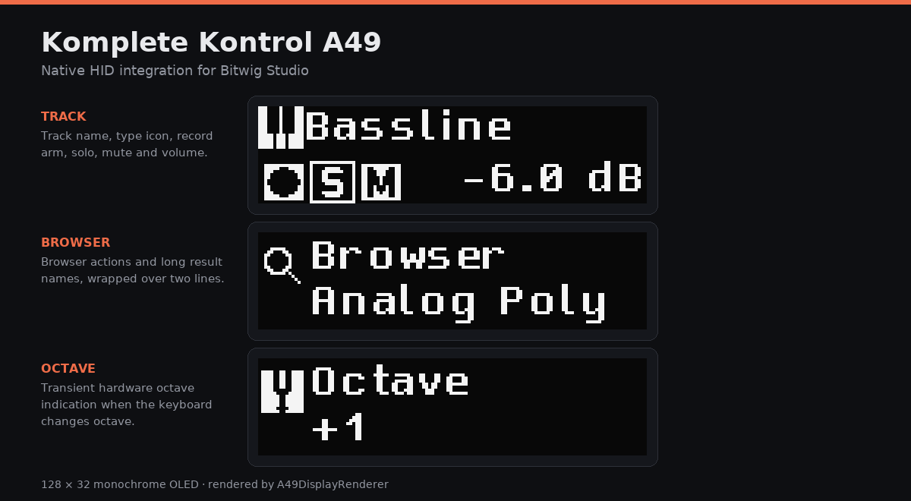
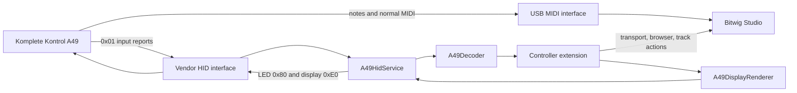

# Komplete Kontrol A49 Driverless

Native HID integration for the **Native Instruments Komplete Kontrol A49** in
Bitwig Studio. No Komplete Kontrol software, no vendor driver, and no MIDI-mode
workaround.

<p align="center">
  
</p>

<p align="center">
  
  
  
  
  
</p>

> **Status:** 0.1.0 · Bitwig 6.0+ · Linux tested · A49 only

**Contents:** [Download](#download) · [Supported models](#supported-models) ·
[Features](#features) · [Installation](#installation) · [Manual](#manual) ·
[How it works](#how-it-works) · [Reverse engineering](#reverse-engineering) ·
[FAQ](#faq) · [Troubleshooting](#troubleshooting) ·
[License](#license-and-trademarks)

> [!NOTE]
> **AI disclosure:** AI tools were used to generate the reverse-engineering
> utilities (HID capture, staged probing, pcap decoding, display painting and
> mirroring, and font/icon extraction) and the writing of this README.
> They were **not** used to write the actual Bitwig extension/driver code.
> All hardware mappings were verified on a physical A49.

## At a glance

| | |
| --- | --- |
| **Bitwig Studio** | 6.0 or newer, Extension API 25 |
| **Hardware** | Native Instruments Komplete Kontrol A49 (`17cc:1740`) |
| **Platforms** | Linux (tested), macOS and Windows (best-effort) |
| **Extension file** | `KompleteKontrolA49Driverless.bwextension` |
| **Version** | 0.1.0 |
| **License** | MIT |

## Download

Prebuilt `.bwextension` files are available from the
[Releases page](../../releases) once a release is published. If no release is
available yet, build the extension from source — it takes one Maven command.

| Required Bitwig | Version | Released | Download |
| --- | --- | --- | --- |
| 6.0+ | 0.1.0 | 2026-11-22 | [Releases](../../releases) · [Build from source](#build-from-source) |

## Supported models

| Manufacturer | Model | Status |
| --- | --- | --- |
| Native Instruments | Komplete Kontrol A49 | **Supported and tested** |
| Native Instruments | Komplete Kontrol A25 / A61 | Untested; the protocol may be similar |
| Native Instruments | Komplete Kontrol M32 | Untested |
| Native Instruments | Komplete Kontrol S-series | Not supported; different integration |

## Features

### Play and arrange

- Play, stop, record and restart.
- Count-in toggle, metronome, tap tempo and arranger loop.
- Undo/redo, quantize (MIDI + audio), clear and automation write.
- Arrange / Clip Launcher view cycling and Edit view toggle.

### Mix and navigate

- Previous/next track selection from the encoder.
- Mute and solo the selected track with Shift + Left/Right.
- Mixer view toggle and selected-device window toggle.

### Browse and devices

- Open the add-device browser and insert at the start, before or after the
  selected device.
- Replace-device browser.
- Scroll browser results with the encoder and commit with the knob press.
- Device-panel navigation with explicit add-before/add-after targets.

### Display and LEDs

- 128×32 OLED track card with type icon, name, arm/solo/mute state and volume.
- Transient cards for transport, browser, device and ARP actions.
- Octave offset indicator.
- Dim/bright LED feedback, latched transport/browser states and a reduced
  Shift layer.

### Knobs and MIDI

- Four switchable CC pages for the eight knobs.
- MIDI pass-through for normal keyboard traffic.
- Extra CC messages for HID-only actions, ready for Bitwig's MIDI mapping.
- CC-page remapping for the eight knobs.

### Arpeggiator

- Toggle Bitwig's arpeggiator.
- Edit mode for mode, octaves, rate, gate, shuffle and overlapping notes.

## Installation

### 1. Install the extension

Download `KompleteKontrolA49Driverless.bwextension` from the
[Releases page](../../releases), or build it from source using the
[instructions below](#build-from-source).

Copy the file to the Bitwig extension folder:

| Platform | Folder |
| --- | --- |
| Linux | `~/Bitwig Studio/Extensions/` |
| macOS | `~/Documents/Bitwig Studio/Extensions/` |
| Windows | `%USERPROFILE%\Documents\Bitwig Studio\Extensions\` |

If your Bitwig version supports drag-and-drop, you can also drag the
`.bwextension` file onto the Bitwig window.

> If you previously installed an older development build named
> `KompleteKontrolA49driverless.bwextension`, remove it first so Bitwig does
> not load two copies of the same extension ID.

### 2. Linux device permissions (udev / devfs)

The extension opens the keyboard's raw HID device (`/dev/hidraw*`) to read the
side-panel buttons and encoder and to write the LEDs and OLED. Linux normally
gives these nodes root-only permissions, so install the included udev rule.
These are the Linux udev rules; the same access concept applies to devfs on
systems that use it.

```bash
sudo install -Dm644 packaging/linux/99-komplete-kontrol-a49.rules \
  /etc/udev/rules.d/99-komplete-kontrol-a49.rules
sudo udevadm control --reload-rules
sudo udevadm trigger --subsystem-match=hidraw
```

Unplug and reconnect the keyboard afterwards.

<details>
<summary>Show the udev rule</summary>

```udev
# Native Instruments Komplete Kontrol A49 (USB 17cc:1740)
KERNEL=="hidraw*", SUBSYSTEM=="hidraw", ATTRS{idVendor}=="17cc", ATTRS{idProduct}=="1740", TAG+="uaccess", MODE="0660"

# Alternative for systems without systemd-logind uaccess support:
#SUBSYSTEM=="hidraw", ATTRS{idVendor}=="17cc", ATTRS{idProduct}=="1740", MODE="0660", GROUP="plugdev"
```

</details>

Verify access:

```bash
lsusb -d 17cc:1740
ls -l /dev/hidraw*
getfacl /dev/hidrawX   # replace X with the A49 node
```

If `uaccess` is not available, use the commented group alternative, add your
user to `plugdev`, log out and back in, then reload the rules.

#### Flatpak

Install the udev rule on the host first, then grant the Bitwig Flatpak access to
devices:

```bash
flatpak override --user --device=all com.bitwig.BitwigStudio
```

If the device still cannot be opened, use the native Bitwig package or grant
the device explicitly with Flatseal.

### 3. Enable the controller in Bitwig

Open **Settings → Controllers → Add Controller** and choose:

- **Hardware Vendor:** Native Instruments
- **Hardware Model:** Komplete Kontrol A49 (driverless)
- **MIDI Input:** `KOMPLETE KONTROL A49 MIDI 1` (or the matching A49 port)
- **MIDI Output:** none

Auto-detection is currently enabled for Linux. On macOS and Windows, add the
controller manually.

> Only one controller extension should own the A49's HID interface at a time.
> Disable Native Instruments' own controller script and any other A49
> extension before using this one.

### 4. First-run check

1. Play a few notes — the A49 should behave as a normal MIDI keyboard.
2. Select a track — the OLED should show its name, type, arm/solo/mute state
   and volume.
3. Press Play/Stop/Record — the transport should respond and the LEDs should
   follow.
4. Press Browser — the add-device browser should open.
5. Turn the encoder — the selected track should change.

If something does not work, see [Troubleshooting](#troubleshooting).

### Build from source

Requirements: JDK 17+ and Maven 3.6.3+.

```bash
git clone <repository-url>
cd <repository-directory>
mvn clean package
```

The build produces:

```text
target/KompleteKontrolA49Driverless.bwextension
```

The build uses the Bitwig Maven repository for `com.bitwig:extension-api:25`.
`PureJavaHidApi 0.0.23` is not on Maven Central, so its jar and pom are vendored
in `maven-local-repository/`. JNA is resolved from Maven Central.

The Maven Shade plugin bundles PureJavaHidApi and JNA into the final
`.bwextension`; the Bitwig API remains `provided`. License files are copied
into `META-INF/` inside the jar.

## Manual

The full manual covers button mappings, encoder behaviour, ARP edit mode, knob
CC pages, the MIDI CC map, display/LED behaviour, troubleshooting and known
limitations:

- [`docs/MANUAL.md`](docs/MANUAL.md)

The short version:

| Control | Press | Shift + press |
| --- | --- | --- |
| Play | Play | Restart |
| Stop | Stop | Clear / remove |
| Record | Record | Toggle count-in |
| Loop | Toggle arranger loop | — |
| Metronome | Toggle metronome | — |
| Tempo | Tap tempo | — |
| Undo | Undo | Redo |
| Quantize | Quantize again | Toggle automation write |
| Scale | Cycle Arrange / Clip Launcher | Toggle Edit view |
| Arp | Toggle arpeggiator | Toggle ARP edit mode |
| Ideas | Toggle Mix view | — |
| Browser | Open/close browser | — |
| Plug-in | Toggle device panel | Open MIDI editor |
| Track | Toggle mixer | Toggle device window |
| Left / Right | Knob CC page | Mute / Solo track |
| Preset up / down | Preset browser / scroll / ARP value | — |
| Encoder | Tracks, browser, devices, ARP, loop length | — |

While **Loop** is physically held, the encoder resizes the arranger loop.
While **Shift + Arp** is active, the encoder selects an ARP setting and Preset
up/down changes its value.

## How it works



The extension uses Bitwig's controller API for musical actions and a raw HID
connection for the parts MIDI does not expose:

- input report `0x01` — buttons, encoder, octave indicator;
- LED output `0x80` — button and octave LEDs;
- display output `0xE0` — 128×32 OLED frames;
- feature reports `0xF8`/`0xD0` and mode commands `0xA0` — display
  initialization and shutdown.

HID events are produced on a background thread and drained on the Bitwig
controller thread every 5 ms. The display is rendered locally as a 512-byte,
four-page framebuffer and sent as two 265-byte packets.

More detail:

- [`docs/PROTOCOL.md`](docs/PROTOCOL.md) — report layouts and packet formats
- [`docs/REVERSE_ENGINEERING.md`](docs/REVERSE_ENGINEERING.md) — how the
  protocol was recovered

## Reverse engineering

The protocol was recovered from USB captures and staged hardware probing, not
from an official Native Instruments API. The short version:

1. MIDI/SysEx experiments established what the normal MIDI port exposes.
2. `hidraw` capture and interactive labelling mapped the side-panel buttons,
   encoder and octave indicator.
3. A staged HID probe found the `0x80` LED report; a focused light mapper
   assigned the individual LED bytes.
4. USB endpoint probing ruled out the MK2/qKontrol-style bulk image path on
   this firmware.
5. usbmon captures of the official software, a protocol-aware pcap extractor,
   a Rust display-paint tool and a live display mirror produced the `0xE0`
   display transport and the 128×32 renderer.
6. A charmap tool and an icon converter produced the bitmap font and icons.

The cleaned-up tools are included in the repository:

- [`tools/reverse-engineering/`](tools/reverse-engineering/) — HID capture,
  staged probes, LED mapper, usbmon display extractor and live display mirror.
- [`tools/display-paint/`](tools/display-paint/) — Rust/egui paint program for
  the 128×32 OLED with live packet preview and HID send buttons.

The full story, tool index and reproduction steps are in
[`docs/REVERSE_ENGINEERING.md`](docs/REVERSE_ENGINEERING.md).

> [!IMPORTANT]
> **AI disclosure:** AI tools were used to generate the reverse-engineering
> utilities (capture, probing, pcap decoding, display painting and mirroring,
> font/icon extraction). They were **not** used to write the actual Bitwig
> extension/driver code. The author specified the experiments, verified the
> mappings on a physical A49, and wrote and integrated the final driver.

## FAQ

**Does the A49 still work as a normal MIDI keyboard?**  
Yes. Notes and normal MIDI are passed through to Bitwig.

**Why does Linux need a udev rule?**  
The extension opens `/dev/hidraw*` to reach the side-panel controls, LEDs and
display. Those nodes are root-only by default. The udev rule grants the
locally logged-in desktop user access.

**Does this work with the A25, A61 or M32?**  
It is untested. The A-series keyboards may share part of the protocol, but only
the A49 is supported. The S-series uses a different integration.

**Does the extension upload templates or modify the keyboard firmware?**  
No. It only sends observed HID input/output reports. There is no firmware
upload or template programming.

**Can the extension read the OLED contents back?**  
No. The display is effectively write-only; the extension renders frames
locally and sends them to the keyboard.

## Troubleshooting

### `A49 HID unavailable`

The udev rule is missing or not active, the keyboard was not reconnected after
installing it, or another program has exclusive access.

```bash
sudo udevadm control --reload-rules
sudo udevadm trigger --subsystem-match=hidraw
```

Reconnect the A49 and restart Bitwig. Check `lsusb -d 17cc:1740` and the
permissions/ACL of the matching `/dev/hidraw*` node.

### The extension does not appear

- Put the `.bwextension` in the correct `Extensions` folder.
- Check that the file is not zero bytes.
- Restart Bitwig completely.
- Make sure the Bitwig version supports Extension API 25.

### No display output

The display initializes on the first status message or track selection.

- Confirm that the HID device can be opened.
- Disable any other A49 extension or Native Instruments controller
  integration.
- Restart Bitwig and reselect the controller.

### Notes do not play

Make sure the controller's MIDI input is set to the A49 MIDI port and no other
controller entry is consuming the same port. The extension does not replace
Bitwig's MIDI input handling.

## Known limitations

- Only the A49 has been tested. A25, A61, M32 and S-series keyboards are not
  supported.
- Linux is the primary platform. macOS and Windows code paths are best-effort.
- The display font and icon set are fixed bitmap data; characters outside the
  bundled set fall back to `?`.
- The extension does not implement Native Instruments' browser, preset
  database, touch strip or hardware arpeggiator UI.
- The protocol is reverse-engineered and not covered by a stability guarantee.
- There are currently no automated tests.

## Questions, bug reports and contributions

- Bugs and feature requests: [open an issue](../../issues).
- General questions and show-and-tell: [Discussions](../../discussions).
- Pull requests are welcome. Please include your Bitwig version, operating
  system, keyboard model/firmware if known, and whether the HID device can be
  opened. Run `mvn clean package` before submitting.

This is an unofficial community project. There is no official support from
Native Instruments or Bitwig.

## Credits

- **Bitwig** for the Controller Extension API.
- **Kustaa Nyholm / SpareTimeLabs** for
  [PureJavaHidApi](https://github.com/nyholku/purejavahidapi).
- **JNA** for Java native access.
- The Bitwig community for controller-extension examples and documentation.
- Documentation structure inspired by the
  [DrivenByMoss project page](https://www.mossgrabers.de/Software/Bitwig/Bitwig.html);
  no code from that project is included.

## License and trademarks

The source code is released under the [MIT License](LICENSE). The build
bundles third-party libraries and display assets; see
[`THIRD-PARTY-NOTICES.md`](THIRD-PARTY-NOTICES.md) and the
[`LICENSES/`](LICENSES/) directory.

This is an unofficial community project. It is not affiliated with, endorsed
by, or supported by Native Instruments GmbH or Bitwig GmbH.

Native Instruments, Komplete Kontrol and related names are trademarks of
Native Instruments GmbH. Bitwig and Bitwig Studio are trademarks of Bitwig
GmbH. All other trademarks are the property of their respective owners.

No Native Instruments software, drivers or proprietary source code is included
in this repository. The HID protocol implementation was produced for
interoperability with hardware owned by the user.
